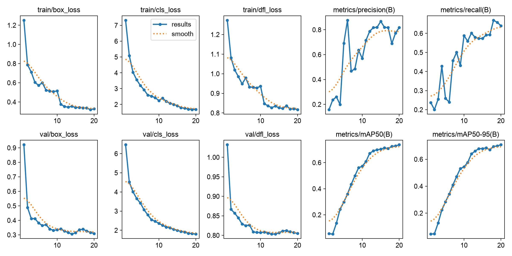
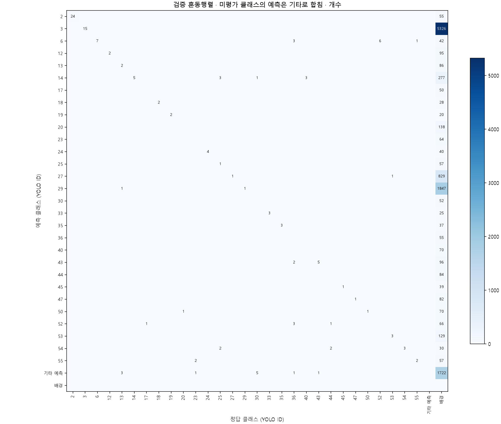

# 내부 알약 객체 탐지 YOLO11n 베이스라인 최종 보고서

작성일: 2026-11-05. 상태: **사전학습 기반 20epoch 학습 및 best.pt 평가 완료**.

후속 [Recall 임계값 실험·저성능 클래스 분석](RECALL_ANALYSIS.md)을 별도로 추가했다.
기존 지표는 보존했으며 후속 분석에서도 추가 학습과 라벨 수정은 하지 않았다.

## 결과와 평가 범위

| 지표 | 값 (0~1) | 백분율 표기 |
|---|---:|---:|
| mAP50 | 0.737463 | 73.75% |
| mAP50-95 | 0.710427 | 71.04% |
| Precision | 0.817668 | 81.77% |
| Recall | 0.640245 | 64.02% |

검증 사진39장·정답132개·29클래스에 대한 개발용 validation 결과다.
학습 모델은56클래스지만 검증에 없는27클래스는 미평가다.
위 값은 전체56종의 독립 test 성능이나 약품 정체의 확정률이 아니다.
기준 지표는 `evaluation/metrics.json`의 Ultralytics native `metrics.box`다.
JSON 내보내기와 함께 출력된 COCO evaluator AP는 구현·집계가 다른 별도 값이므로 혼용하지 않았다.
Precision/Recall은 Ultralytics 요약 지표이며
예측 그림의 기본 conf=0.25와 동일한 운영점을 보장하지 않는다.

## 데이터와 QA

내부 학습 후보232사진·763라벨·56클래스를 사용했다. 외부 데이터는 학습에 넣지 않았다.
구조 오류와 기존 검수 보류를 사진 단위로 합쳐35사진·103라벨을 REVIEW로 제외했다.
PASS197사진·660라벨·56클래스가 남았고, 원본 이미지·JSON은 수정하지 않았다.
원본232사진·763JSON의 지문과 복사197사진, 전체660라벨의 좌표 역변환 검증을 통과했다.

| 분할 | 사진 | 라벨 | 클래스 |
|---|---:|---:|---:|
| train | 158 | 528 | 56 |
| validation | 39 | 132 | 29 |

기존 촬영·유사 이미지 그룹73개를 쪼개지 않고 train의 모든 클래스를 보존한 채
사진 수80:20 근접도를 우선해 정수 최적화했다. 실제 비율은80.20:19.80이다.
정의된 촬영·SHA256·pHash 관계에서 split 누수는0건이었다.
모든 시각적 유사성에 대한 완전한 중복 제거를 뜻하지는 않는다.
PASS 감사 표본56어노테이션/49사진은 사람 검수 대기 상태이며 자동 PASS는 의미상 정확성 보증이 아니다.
정답 없는 test 이미지842장은 이번 정량 평가에 사용하지 않았다.

## 학습 설정과 실행 환경

| 항목 | 실제 실행 |
|---|---|
| 모델 | YOLO11n, yolo11n.pt 사전학습 초기화 |
| epochs / image size / batch / seed | 20 / 640 / 8 / 42 |
| GPU | NVIDIA GeForce RTX 5070 약12GB |
| Python / torch / torchvision | 3.14.2 / 2.14.0+cu130 / 0.29.0+cu130 |
| Ultralytics | 8.4.193 |
| optimizer | auto, 로그에서 AdamW 선택 |
| dataloader / cache | workers0 / cache=False |
| AMP / deterministic | True / True |
| epoch별 train+val 누적 시간 | 98.5073초 (초기 다운로드·설정 시간 제외) |
| GPU 메모리 | 학습 로그에서 약1.5GB 관측, 최대값 별도 측정은 하지 않음 |
| OOM / batch 변경 | 없음 / 8 유지 |

기존 Python3.12/cu126은 GPU 인식 후 실제 연산에 실패했다.
기본 연산과 YOLO forward를 통과한 Python3.14/cu130으로 실제 학습까지 완료했다.
AMP 확인용으로 라이브러리가 내려받은 YOLO26n은 이 실험의 학습 모델이 아니다.
평가 JSON 내보내기에 사용된 faster-coco-eval 1.8.0도 의존성에 기록했다.

## 학습 경향

20epoch 동안 학습·검증 loss가 전반적으로 감소하고 mAP가 상승했다.
epoch11부터 기본 close_mosaic=10 설정에 따라 mosaic이 꺼져 학습 조건 변화가 포함된다.
단일 seed·작은 검증셋의 결과이므로 일반화 성능이나 과적합 부재를 확정하지 않는다.
추가 epoch·하이퍼파라미터 탐색은 이번 승인 범위에서 실행하지 않았다.

## 혼동행렬과 낮은 성능의 클래스

축의 숫자는 YOLO class ID이며 [전체 매핑](results/yolo11n_20261105/class_map.csv)에 이름·제품 코드가 있다.
미평가27클래스의 예측을 기타 행으로 합쳐 오류 수를 보존했다. 원본 전체 행렬도 별도 보관했다.
이 행렬은 검증 기본 confidence=0.001, 매칭 IoU=0.45 기준이다.
낮은 confidence의 배경 오탐도 포함하므로 conf=0.25 예측 그림이나 요약 Precision과 직접 비교하지 않는다.

| 검증 라벨 기준 클래스 | 정답 수 | AP50 |
|---|---:|---:|
| 자누비아정 50mg | 6 | 0.0215 |
| 트라젠타듀오정 2.5/850mg | 3 | 0.0218 |
| 콜리네이트연질캡슐 400mg | 1 | 0.0995 |
| 트윈스타정 40/5mg | 9 | 0.2703 |
| 플라빅스정 75mg | 6 | 0.2741 |

클래스마다 표본이1~24개로 작고 편중돼 있다. 낮은 점수의 원인을 사진·오라벨·혼동·학습 부족으로
분리해 확인해야 하며, 모델 예측이나 원본 라벨만으로 실제 약품 정체를 판정하지 않는다.
미평가 클래스의 지표를0점으로 채우지 않고 NOT_EVALUATED로 보존했다.

## 저장 결과와 재현

- 로컬 가중치: `yolo11n_baseline_20261105_run2/best.pt`, SHA256 `ca443f82b8761d2fabf36ff2f589a744c5fde5f8710a6e8ec676e203f0aefa58`.
- 로컬 평가: `evaluation/metrics.json`, `per_class_metrics.csv`, `validation/`, `predictions/`.
- 예측16사진은 검증 파일명 순 첫16장으로 정했으며 좋은 결과만 골라 보여 주지 않았다.
- GitHub에는 집계 지표·차트·코드·이미지 미포함 EDA를 제공한다.
  원본 사진·예측 사진·가중치는 제외한다.
- [지표 JSON](results/yolo11n_20261105/metrics.json), [클래스별 지표](results/yolo11n_20261105/per_class_metrics.csv),
  [학습 설정](results/yolo11n_20261105/training_config.yaml), [재현 지문](results/yolo11n_20261105/provenance.json).
- 실행 방법은 [README](../README.md), 준비 과정은 [사전 검사 기록](YOLO11N_PREFLIGHT.md)을 따른다.

seed와 환경 버전을 기록했지만 다른 하드웨어·패키지 버전에서 비트 단위 재현을 보장하지 않는다.
학습에 쓴 validation으로 best checkpoint를 선택했으므로 독립적인 최종 test가 추가로 필요하다.
