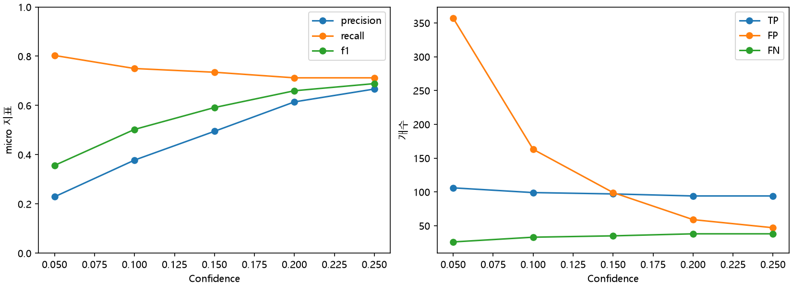
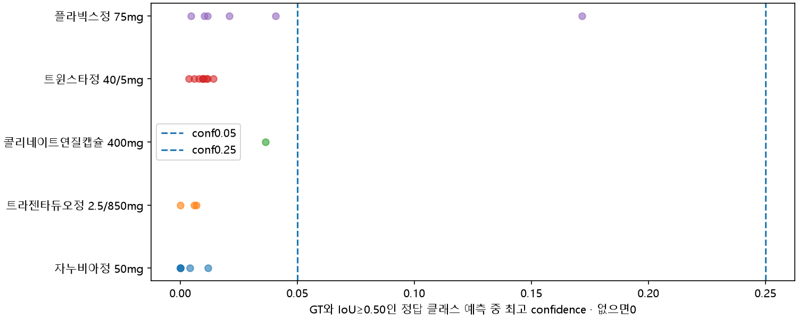

# YOLO11n Recall 임계값 실험과 저성능 클래스 원인 분석

작성일:2026-11-05. **추가 학습·모델 교체·라벨 수정 없음.**
기존 best.pt와 기존 평가를 보존하고 낮은 confidence로 저장한 검증 예측을 재사용했다.
로컬 상세 자료: `yolo11n_recall_analysis_20261105_final`. 기존 베이스라인은 [최종 보고서](FINAL_REPORT.md)를 참고한다.

## 결론

지정한 다섯 값 중 전체 micro F1은 **conf0.25에서0.6886으로 가장 높다**.
0.25→0.05에서 Recall은0.7121→0.8030으로9.09%p 증가하지만
Precision은0.6667→0.2289로43.77%p 감소한다. TP12개 증가에 FP310개가 추가된다.
0.20은0.25와 TP94개로 같고 FP만12개 많으므로 이번 표에서 이점이 없다.
현재 다섯 후보 중0.25를 유지하는 것이 합리적이다. 전체 가능한 임계값의 최적점이라는 뜻은 아니다.
오탐 비용·최소 Precision 요구가 정해지면 그 조건으로 다시 선택해야 한다.

저성능 5종의 검증 GT25개 중 conf0.05에서는 **24개가 위치는 맞는 다른 클래스 예측**이고
나머지1개는 정답 TP다. 단순한 알약 위치 미검출보다
분류 실패와 표본·가시적 특징 범위 부족이 두드러진다.
이 진단은 원본 라벨을 임시 기준으로 한 모델 오류 분석이며 실제 약품 정체의 확정이 아니다.
다음 단일 변수 실험으로는 **클래스 불균형 개선을 위한 train 이미지 샘플링 변경**을 우선 제안한다.
라벨 검수와 가시적 면의 학습 범위 확인이 선행돼야 하며 재학습은 실행하지 않았다.

## 같은 조건으로 계산한 threshold별 지표

| threshold | TP | FP | FN | precision | recall | f1 |
| --- | --- | --- | --- | --- | --- | --- |
| 0.0500 | 106 | 357 | 26 | 0.2289 | 0.8030 | 0.3563 |
| 0.1000 | 99 | 163 | 33 | 0.3779 | 0.7500 | 0.5025 |
| 0.1500 | 97 | 99 | 35 | 0.4949 | 0.7348 | 0.5915 |
| 0.2000 | 94 | 59 | 38 | 0.6144 | 0.7121 | 0.6596 |
| 0.2500 | 94 | 47 | 38 | 0.6667 | 0.7121 | 0.6886 |



- 동일 validation39사진·132GT·29개 GT 클래스, 모델 출력은56클래스를 모두 포함했다.
- 기존 `evaluation/validation/predictions.json`: imgsz640, batch8, 검증 conf0.001,
  NMS IoU0.7, max_det300, class-aware NMS, multi_label=True의 사후 NMS 결과다.
- custom JSON category_id는1부터 시작하므로 YOLO class ID=category_id−1로 복원했다.
- 각 threshold 이상 예측만 남긴 뒤 사진별 confidence 내림차순으로 처리했다.
  같은 클래스의 아직 연결되지 않은 GT 중 가장 높은 IoU≥0.50를 일대일 매칭한다.
  같은 GT에 대한 추가 예측은 FP다. 다른 클래스 예측은 GT의 TP가 될 수 없다.
- TP=매칭된 예측 수, FP=나머지 예측 수, FN=연결되지 않은 GT 수.
  P=TP/(TP+FP), R=TP/(TP+FN), F1=2TP/(2TP+FP+FN).
- 전체는 모든56클래스의 카운트를 먼저 합친 micro 지표다.
  클래스별0분모는 빈칸/미정의이며, validation GT가 없는27종 Recall은 평가하지 않는다.
  그27종으로 잘못 예측한 FP는 전체 Precision에 포함한다.
- 기존 보고서의 P/R은 native 요약 운영점 및 클래스 평균이다. 이번 고정 threshold의 micro P/R과
  직접 증감 비교하지 않는다. **동일 조건의0.25 행을 이번 실험의 비교 기준**으로 사용한다.
- 배포용 단일클래스 `predict()` 출력과 검증 multi-label NMS 출력은 다를 수 있다.
  이 표를 기존 예측 갤러리의 conf0.25 성능이라고 부르지 않는다.
- JSON 좌표는 소수3자리·score는5자리 반올림이다. 원시 tensor와 극미한 경계 차이가 가능하다.
  재추론 없이 원래 평가 조건을 보존한 캐시 기반 분석이다.
- AP50은 confidence 전체 순위를 사용하는 지표다.
  임계값만 바꿔 기존 AP50이 개선됐다고 주장하지 않는다.

## 저성능 클래스의 표본과 conf0.25 결과

| 클래스 | Train 사진/라벨 수 | Train 그룹 | Val 사진/라벨 수 | Val 그룹 | TP | FP | FN |
| --- | --- | --- | --- | --- | --- | --- | --- |
| 자누비아정 50mg | 3 | 1 | 6 | 2 | 0 | 0 | 6 |
| 트라젠타듀오정 2.5/850mg | 5 | 1 | 3 | 1 | 0 | 0 | 3 |
| 콜리네이트연질캡슐 400mg | 14 | 3 | 1 | 1 | 0 | 0 | 1 |
| 트윈스타정 40/5mg | 2 | 1 | 9 | 2 | 0 | 0 | 9 |
| 플라빅스정 75mg | 9 | 5 | 6 | 2 | 0 | 1 | 6 |

해당5종에서는 사진마다 그 클래스 GT가1개라 사진 수와 라벨 수가 같다.
전체 train 클래스별 라벨은2~104개, 중앙값6.5개다. 자누비아·트윈스타는 특히 적고 그룹도1개다.
그룹은 독립 개체 수를 보장하는 단위가 아니라 기존 촬영·유사 이미지 묶음이다.

## 실패 유형과 실제 혼동

정량 TP를 먼저 확정한 뒤 남은 GT와 예측만 진단한다.
Classification Failure는 클래스 무관 IoU≥0.50 일대일 매칭이 있는 FN,
Localization Failure 후보는 그 이후 남은 같은 클래스 예측과 IoU≥0.10인 FN,
Detection Failure는 나머지 FN이다. 마지막 범주는 **그 threshold에서의 잔여 누락**이며
실제 알약을 전혀 못 보았다는 확정이 아니다. 낮은 threshold에서는 유형이 바뀔 수 있다.
Localization 후보의 정확한 IoU는 개별 CSV에 남겨 매칭 경쟁·중복 GT 가능성도 검토한다.
낮은 IoU의 다른 클래스 예측처럼 두 오류가 함께 있는 경우 원인을 단독 확정할 수 없다.

| threshold | pill_name | failure | count |
| --- | --- | --- | --- |
| 0.0500 | 자누비아정 50mg | Classification Failure | 6 |
| 0.0500 | 콜리네이트연질캡슐 400mg | Classification Failure | 1 |
| 0.0500 | 트라젠타듀오정 2.5/850mg | Classification Failure | 3 |
| 0.0500 | 트윈스타정 40/5mg | Classification Failure | 9 |
| 0.0500 | 플라빅스정 75mg | Classification Failure | 5 |
| 0.0500 | 플라빅스정 75mg | TP | 1 |
| 0.2500 | 자누비아정 50mg | Classification Failure | 3 |
| 0.2500 | 자누비아정 50mg | Detection Failure | 3 |
| 0.2500 | 콜리네이트연질캡슐 400mg | Detection Failure | 1 |
| 0.2500 | 트라젠타듀오정 2.5/850mg | Classification Failure | 1 |
| 0.2500 | 트라젠타듀오정 2.5/850mg | Detection Failure | 2 |
| 0.2500 | 트윈스타정 40/5mg | Classification Failure | 5 |
| 0.2500 | 트윈스타정 40/5mg | Detection Failure | 4 |
| 0.2500 | 플라빅스정 75mg | Classification Failure | 3 |
| 0.2500 | 플라빅스정 75mg | Detection Failure | 3 |

conf0.25의 주요 혼동 상대:

| pill_name | predicted_name | count |
| --- | --- | --- |
| 자누비아정 50mg | 가바토파정 100mg | 3 |
| 트라젠타듀오정 2.5/850mg | 로수바미브정 10/20mg | 1 |
| 트윈스타정 40/5mg | 뉴로메드정(옥시라세탐) | 2 |
| 트윈스타정 40/5mg | 아토젯정 10/40mg | 2 |
| 트윈스타정 40/5mg | 엑스포지정 5/160mg | 1 |
| 플라빅스정 75mg | 크레스토정 20mg | 3 |

이때 자누비아→가바토파는 IoU0.952~0.982, 플라빅스→크레스토는0.955~0.977이다.
박스 위치는 충분히 맞는데 클래스가 틀린 사례다. 자누비아→트라젠타듀오라는 예시는
이번0.25 사례에서는 확인되지 않았다.
우선5종에는 두 threshold 모두 Localization Failure 후보가0개다.
이 결과만으로 bbox가 모두 정확하다거나 위치 오류가 전체 데이터에 없다고 보증하지 않는다.

## Confidence 분포

| pill_name | min | median | max |
| --- | --- | --- | --- |
| 자누비아정 50mg | 0.0000 | 0.0000 | 0.0118 |
| 콜리네이트연질캡슐 400mg | 0.0363 | 0.0363 | 0.0363 |
| 트라젠타듀오정 2.5/850mg | 0.0000 | 0.0059 | 0.0068 |
| 트윈스타정 40/5mg | 0.0037 | 0.0097 | 0.0142 |
| 플라빅스정 75mg | 0.0046 | 0.0163 | 0.1717 |



GT마다 IoU≥0.50인 정답 클래스 캐시 예측 중 최대값의 분포다.
0은 점수 자체가0이라는 뜻이 아니라 conf0.001/NMS/max_det 이후 해당 예측이 없다는 뜻이다.
자누비아 최대0.01178, 트라젠타듀오 최대0.00677, 트윈스타 최대0.01422로
0.05까지 낮춰도 복구되지 않는다. 플라빅스 한 건은0.17174여서0.15에서만 복구된다.
전체 예측의 클래스별 TP/FP confidence 요약은 `prediction_confidence_summary.csv`,
로컬 `prediction_outcomes.csv`에는 threshold별 모든 예측의 좌표·confidence·TP/FP를 기록했다.

## 이미지와 원본 라벨 검토

우선5종의 PASS58GT(train33+val25)를5개 contact sheet로 모두 확인했다.
에이전트의 시각 관찰이며 사람의 최종 승인과 구분한다. 정체는 UNVERIFIED로 남겼다.

- 자누비아: 원형·베이지/황색 계열이며112로 보이는 각인, train/val의 외형이 대체로 유사하다.
  단순히 AP가 낮아서 오라벨이라고 볼 근거는 없다.
- 트라젠타듀오: train5장은 로고 면, val3장은 D2/850 문자 면으로 보인다.
  양면의 가시적 특징 범위 차이가 뚜렷한 원인 후보다.
- 콜리네이트: 타원형 황색 연질캡슐과 HM-CN으로 보이는 인쇄.
  카탈로그 color_class1=갈색과 chart=연한 노란색의 표현도 달라 독립 확인이 필요하다.
- 트윈스타: A1과 로고로 보이는 흰 타원정이며 train/val의 보이는 면은 대체로 같다.
  train2장만으로는 다양성이 매우 부족하다.
- 플라빅스: train9장은75 면, val6장 중3장은1171 면으로 보인다.
  나머지3장은75 면으로 보이며 그 중1건만 낮은 threshold에서 정답 탐지됐다.

GT 박스는 contact sheet에서 대체로 알약 몸통을 포함하는 모습이었다.
육안 확대만으로 픽셀 단위 경계 적합성·보이지 않는 면·제품 정체를 인증할 수는 없다.
`label_review.csv`는58개 모두 자동 REVIEW/사람 PENDING이며 기존 데이터셋 PASS를 덮어쓰지 않았다.
원본 JSON 경로·SHA256·품목기준코드·각인·색·모양을 보존했다.
`gt_outcomes.csv`에는25GT×5threshold의 매칭 결과와 근거를 포함해 전체132GT를 기록했다.
로컬 `review_gallery.html`에서는 동일 GT를 **GT 확대 / conf0.05 / conf0.25** 가로3열로 비교한다.
초록 GT·빨강 예측이며 관련 클래스명·파일명·제품 코드·좌표·원본 JSON 경로를 제공한다.

독립 정보 대조의 확인 범위(2026-11-05 접속):

- [종근당 자누비아50mg 제품 정보](https://www.ckdpharm.com/product/productView.do?prodCode=CKD0000395)는
  밝은 베이지색·원형·112 각인을 설명한다.
  관찰은 이 설명과 양립하지만 사진의 제품 정체 확정은 아니다.
- [유한양행 트윈스타 제품 정보](https://yuhan.co.kr/Products/List/?YPRD_IDX=2215&mode=view)는
  흰색/연한 파란색 타원 이중정과40/5mg 제품을 확인해 준다. 이 사진에서 뒷면 색을 확인한 것은 아니다.
- [사노피 제품 목록](https://www.sanofi.com/ko/south-korea/product-information)에서
  플라빅스75mg·보험코드652101570은 확인했다. 이 목록만으로 각인75/1171을 독립 검증하지 못했다.
- 트라젠타듀오의 국내 제조사 페이지는 접근 제한, 식약처 상세 페이지는 도구 접근 오류가 있었다.
  콜리네이트의 공식 외형·각인 정보는 이번 조회에서 확보하지 못했다.
  해당 두 제품 및 플라빅스 각인은 정확한 국내 품목·제조시점 정보로 추가 확인해야 한다.
  해외 동일 성분 제품 정보를 국내 제품의 확정 근거로 대체하지 않았다.
- 원본 JSON의 각인·색상·모양은 데이터셋 주장이다. 공식 외부 정답으로 취급하지 않았다.
  OCR·분류 모델을 별도로 실행하거나 그 결과로 라벨을 수정하지 않았다.

## 다음 한 변수 실험 추천

**클래스 불균형 개선: train 이미지 샘플링만 변경**하는 비교를 우선 추천한다.
자누비아3개·트윈스타2개·트라젠타듀오5개이고, 위치가 맞는 오분류가 다수인 점이 근거다.
구체적 초안은 클래스별 train 라벨 수 n의 중앙값6.5를 기준으로
클래스 가중치 min(3, max(1, sqrt(6.5/n)))를 만들고,
다중 알약 사진은 포함 클래스의 최대 가중치를 사용해 이미지 단위 복원 추출하는 방식이다.
seed42, epoch20, imgsz640, batch8, 초기 사전학습 가중치와 분할·증강·optimizer 설정은 유지한다.
epoch당 학습 배치 수20도 유지한다. YOLO 기본 shuffle에 이 가중치가 자동 적용된다고 주장하지 않으며,
실험 전 sampler 구현과 실제 클래스별 노출 수를 별도 확인해야 한다.

단, 복제 샘플링으로 새로운 각인 면이 생기지는 않는다.
트라젠타듀오·플라빅스의 보이는 면 차이는
독립 촬영과 양면 데이터 확보로 해소해야 할 별도 데이터 과제다.
검수 없이 표본을 반복하면 오라벨도 증폭하므로 사람 검수 후 실험을 승인해야 한다.
새 데이터를 넣는 실험은 분리하고 기존 validation을 train으로 이동하거나 그룹을 쪼개지 않는다.

다른 후보의 우선순위를 낮춘 이유:

학습 곡선의 mAP50은 epoch10=0.57224, epoch15=0.70281, epoch20=0.73730이었다.
같은 지점의 validation cls loss는2.3617→1.99877→1.80229로 감소했다.
이는 추가 학습 가능성을 남기지만 희소 클래스의 원인이나 일반화 성능을 확정해 주지 않는다.

- Epoch 증가: 전체 mAP50이 epoch15~20에서도 상승해 가능성은 있다. 다만 같은2~5표본 반복으로
  분류·가시적 면 부족을 해결한다고 보장할 수 없다.
  마지막 epoch가 최적이면 수렴 미완료 가능성으로 남긴다.
- Image size 증가: 각인 해상도에는 도움 가능하지만 현재5종은 conf0.05에서 위치 매칭이 이미25/25다.
  주된 확인 증거는 위치보다 제품 클래스 문제다. 해상도 효과를 배제하는 결론은 아니다.
- 증강 변경: 반복 회전·조명 사진이 이미 있고 train에 없는 반대편 각인은 회전으로 만들 수 없다.
  강한 블러·색변환·뒤집기가 식별을 해칠 수 있어 먼저 적용하지 않는다.

비교 기준은 동일 IoU0.50에서 conf0.25 고정 micro P/R/F1, 같은 per-class AP50,
5종 TP/FP/FN과 실패 유형이다. 최소 Precision을 합의한 뒤 조건부 Recall도 확인한다.
validation으로 임계값을 골랐으므로 최종 성능 주장은 별도의 독립 test에 남긴다.

## 결과 파일과 재현

- 공개 집계: `docs/results/recall_20261105_final/` 아래 threshold 전체·클래스별 CSV, 지원 수, 혼동 쌍,
  confidence 요약, 실패 유형, 집계 차트, 학습 곡선 체크포인트.
- 로컬 원본 증거: `analysis_manifest.json`, `gt_outcomes.csv`, `prediction_outcomes.csv`,
  `label_review.csv`, contact sheet5개와 인덱스, 사례 이미지25개, `review_gallery.html`.
- 입력 best.pt·기존 metrics/predictions·학습 곡선·data.yaml·split manifest·class map은 실행 전후
  SHA256이 일치했다. 원본58JSON도 준비 시점의 SHA256과 대조했다.
- 코드: `models/analyze_recall.py`, `models/export_recall_report.py`.
  학습 호출은 없으며 기존 모델·기존 평가·원본 이미지·JSON을 수정하지 않았다.

재실행 시 환경변수에 실제 경로와 **존재하지 않는 새 출력 폴더**를 지정한다.

```powershell
uv run --no-project --python 3.14 python -m models.analyze_recall `
  --run-dir $env:PILL_RUN_DIR --dataset $env:PILL_YOLO_DATA_DIR `
  --raw-root $env:PILL_INTERNAL_DATA_DIR --output-dir $env:PILL_RECALL_DIR
uv run --no-project --python 3.14 python -m models.export_recall_report `
  --analysis $env:PILL_RECALL_DIR --run-dir $env:PILL_RUN_DIR `
  --destination $env:PILL_RECALL_PUBLIC_DIR
```
